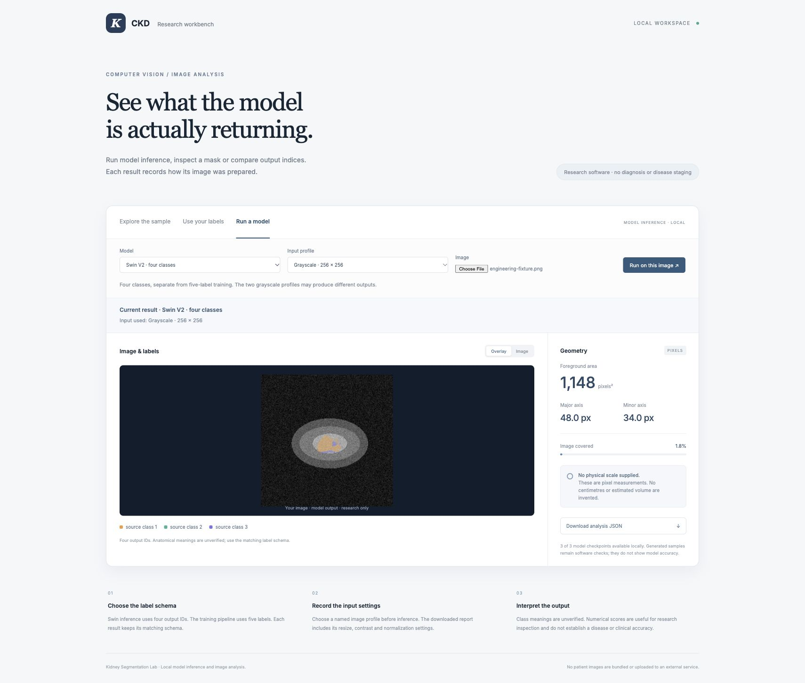
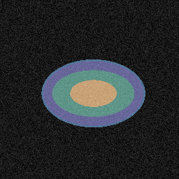

# Kidney Segmentation Lab

A local workbench for model inference, labelled-image analysis and segmentation
experiments. Run Swin V2, EfficientNet-B4 and ConvNeXt models, inspect their
outputs, measure labelled regions and export results from the browser or CLI.



## Quick start

Use Python 3.12 or newer. Python 3.12 on macOS is the tested local environment.

```bash
python3 -m venv .venv
source .venv/bin/activate
python -m pip install -e '.[ml,test]'
ckd fetch-models --models-dir models
ckd serve --models-dir models
```

Open **http://127.0.0.1:8782**. In Windows PowerShell, activate the environment
with `.\.venv\Scripts\Activate.ps1`. Stop the server with Ctrl+C.

Model downloads require the [GitHub CLI](https://cli.github.com/) and access to
this private repository. The downloader uses your existing sign-in and checks
every file’s SHA256. It preserves existing files. The model registry pins the
assets in release `v1.1.0`; the application version is independent of that asset
version. No credentials or model binaries are stored in Git.

For the generated sample and manual mask analysis, install with
`python -m pip install -e .`. Those features work without model downloads or
PyTorch. Images are processed locally; the server binds to localhost.

## Run inference

In **Run a model**, choose a model, input profile and image. The result keeps its
model name and input settings when you prepare the next run. Downloads contain
the weight hash, runtime configuration, input settings and numerical output.
Only one model is loaded at a time.

| Model | Output | Input profiles |
| --- | --- | --- |
| Swin V2 tiny | Four pixel-label IDs | Grayscale 256; grayscale 256 with CLAHE |
| EfficientNet-B4 | Two output indices | RGB 224 or RGB 380 with ImageNet normalization; RGB 224 unit range |
| ConvNeXt tiny | Two output indices | RGB 224 or RGB 380 with ImageNet normalization; RGB 224 unit range |

```bash
ckd models --models-dir models
ckd run-model --id source-swin-four --profile source-training-256 \
  --image image.png --models-dir models --output results/swin
ckd run-model --id source-swin-four --profile source-clahe-256 \
  --image image.png --models-dir models --output results/swin-clahe
ckd run-model --id biopsy-efficientnet --profile research-rgb-224 \
  --image image.png --models-dir models --output results/efficientnet
ckd run-model --id sclerosis-convnext --profile research-rgb-224 \
  --image image.png --models-dir models --output results/convnext
```

The two Swin profiles use different grayscale decoding and resize methods.
The CLAHE profile also changes local contrast. Classifier profiles are explicit
research settings; their training input recipe and output class order are not
documented. See the [model card](docs/MODEL_CARD.md) before interpreting results.

If you have the checkpoint files listed in the registry, convert them locally:

```bash
ckd import-models --source-dir /path/to/checkpoints --models-dir models
```

Import accepts only the registered hashes. Restricted tensor loading checks
names, shapes and finite values before writing safetensors. Input files stay
unchanged. The private asset release also contains the `.pth` files; use
`ckd fetch-models --models-dir models --include-originals` to download them.

## Analyze masks and geometry

```bash
ckd demo --output results/demo
ckd analyze --image image.png --mask labels.png --output results/analysis
ckd analyze --image image.png --mask labels.png --spacing 0.25 0.30 --output results/calibrated
ckd analyze --image image.png --mask labels.png --label-schema source-four --output results/four-class
ckd check-data --manifest data/manifest.csv
ckd batch --manifest data/manifest.csv --output results/batch
```

Exports contain the image, JSON and, for segmentation, the mask and overlay.
Batch analysis also writes CSV. Spacing is **row mm/pixel, column mm/pixel**
for the input image. Without calibration, measurements stay in pixels. Volume
also requires an independently measured third dimension via `--depth-mm`.
Separate output folders are required for segmentation and classification.



## Train a five-label segmenter

```bash
ckd train --manifest data/manifest.csv --output checkpoints/experiment --epochs 10
ckd predict --model checkpoints/experiment/model.json --image image.png --output results/prediction
python -m pytest
```

The training pipeline preserves region IDs and uses a five-label contract.
It is separate from the four-output checkpoint: model classes, manifests,
result schemas and legends remain distinct. Weights are never silently relabelled.

Use the [data guide](docs/DATA.md) to prepare patient-separated manifests.
Duplicate image content across splits is rejected. Training starts with random
weights unless `--pretrained-backbone microsoft/swinv2-tiny-patch4-window8-256`
is selected. That option downloads a backbone, not a trained kidney segmenter.
Focal loss and cross-entropy are available.

## Scope

This is research software for inspecting numerical outputs and labelled images.
It does not diagnose disease or assign stages. Checkpoint class meanings and
training-data identity are unverified. Index scores are not calibrated disease
probabilities. Scientific performance claims require licensed labelled data and
independent evaluation. Generated samples test software behavior only.

Read the [architecture](docs/ARCHITECTURE.md), [model card](docs/MODEL_CARD.md),
[data guide](docs/DATA.md), [test guide](docs/VERIFICATION.md) and
[attribution and use notes](docs/PROVENANCE.md).
