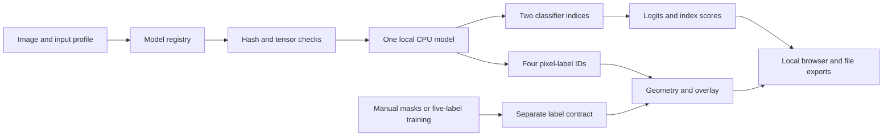

# Architecture

## Registered inference

`model_registry.json` defines model identities, checkpoint and safetensors
hashes, the private asset release and allowed input profiles. `supplied.py`
implements model builders, restricted checkpoint import, image preparation and
the shared CLI/HTTP inference runner. Importing the UI loads no model or asset.

A process lock permits one model operation at a time. Models and tensors are
released afterward. CPU inference uses two threads. No model or dataset is
downloaded implicitly. The fetch command uses GitHub CLI authentication, checks
each asset in a temporary folder and publishes it without replacing an existing file.

## Label contracts and training

`contracts.py` separates `source-four` from `corrected-five`. The registered
Swin model has four output channels; the training pipeline has five. Every
report and legend carries its schema. Geometry can be shared without assigning
anatomical names or relabelling a checkpoint.

`model.py` shares the Swin backbone and decoder between explicit four- and
five-output classes. Spatial hidden states provide the decoder input.
`training.py` uses a fixed seed, patient-separated splits, two CPU threads and
no worker subprocesses. `dataset.py` combines images, capsule masks and region
masks while preserving region IDs. Training and prediction use the same input
contract. The registered four-class model has two separately named input profiles.

Training manifests contain architecture, labels, input settings, weight hash
and the current run’s record. Registered inference uses the fixed model registry.
Both paths load safetensors strictly. The explicit importer can read the exact
hash-bound `.pth` checkpoints with `weights_only=True`. A limited NumPy
scalar/dtype allowlist supports the Swin file’s saved metric; no custom Python
class or unrestricted pickle execution is permitted.

## Analysis and serving

`pipeline.py` returns masks to the input image dimensions before measurement.
Physical units require calibration, which may differ by axis. Ellipsoid volume
also requires an independently measured third dimension. No assumed scan depth
or image-dimension disease rules are used.

`server.py` binds to localhost, bounds request sizes, rejects cross-origin
requests and accepts image bytes rather than filesystem paths. The browser
requires an input profile before inference. Each result keeps its own model
identity and settings. Classifier exports contain both logits and index scores;
they contain no disease label or ensemble verdict.
