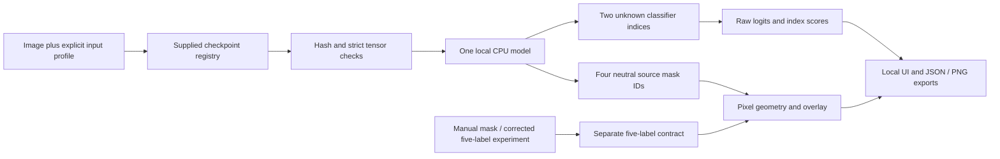

# Architecture

`model_registry.json` owns the three supplied identities, exact original and
safetensors hashes, private release location and permitted input choices.
`supplied.py` owns their strict offline builders, reviewed restricted import,
input preparation and common inference runner. CLI and HTTP use that same
runner. Importing the UI does not load PyTorch, a model or a remote asset.

A process lock permits one supplied model operation at a time; tensors and
models are released after each operation. CPU model work uses two threads.
No pretrained model or dataset is downloaded implicitly. The fetch command
uses existing GitHub CLI authentication and verifies assets in a temporary
folder before making them available.

`contracts.py` separates `source-four` from `corrected-five`. The source model
has four output channels. Corrected training still requires five. Reports and
legends carry their schema ID and never turn a four-channel checkpoint into a
five-label model. Geometry is reusable; anatomy names are not inferred.

`model.py` shares the Swin backbone/decoder mechanics between explicit four-
and five-output classes. It uses spatial hidden states rather than guessing a
square token grid. `training.py` remains the five-label experiment with fixed
seed, explicit patient splits, two CPU threads and no worker subprocesses.

`dataset.py` preserves the original three-file layout without overwriting
region IDs. The corrected training and prediction use the same preprocessing.
The supplied source checkpoint has separate, named training/inference recipes;
their CLAHE discrepancy remains visible.

Training manifests contain architecture, labels, input contract, weight hash
and this run’s record. Supplied models use the separate fixed registry. Both
paths load safetensors strictly. Only the explicit importer reads the three
hash-bound original `.pth` files with `weights_only=True`; a narrowly scoped
trusted NumPy scalar/dtype allowlist handles the Swin metric. No custom code is
allowlisted and unrestricted pickle is never used.

`pipeline.py` returns masks to the original image size before measuring.
Spacing can differ by axis; physical units require actual calibration. An
independently supplied third dimension is required for ellipsoid volume. No
legacy disease rules or assumed scan depth are used.

`server.py` binds to localhost, bounds request sizes, rejects cross-origin
requests and accepts image bytes rather than filesystem paths. The browser
records an explicit input choice before a model run. Classifier JSON contains
both logits and index scores; it contains no disease label or ensemble verdict.

The old YOLO checkout is unrelated to these custom model paths. Upgrading that
object detector would not recover the supplied segmentation or classifier work.
It and the bundled Windows environment remain excluded.
