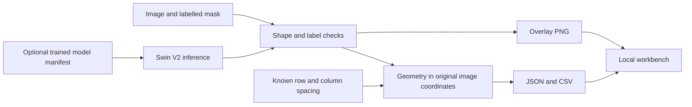

# Architecture

`contracts.py` owns the neutral label IDs and valid physical spacing. Every
workflow uses it. `dataset.py` imports the original three-file layout, validates
patient separation and supplies the same grayscale resize/normalization for
training and prediction. There is no inference-only CLAHE step.

`model.py` preserves the source backbone/decoder design while using spatial
hidden states rather than guessing a square grid from token counts. The model
returns logits at the input size. `training.py` uses explicit splits, a fixed
seed, two CPU threads and no worker subprocesses. It records the data-manifest
hash, initialization, epochs and this run's validation metrics.

Checkpoints contain `model.safetensors` and `model.json`, with an architecture,
label contract, preprocessing identifier, weight hash and training record.
Loading validates that manifest and strict parameter shapes. It does not
silently download a model, change labels or allow arbitrary pickle objects.
`import_legacy_checkpoint` is an explicit trusted-state-dictionary conversion
function using `weights_only=True`; incompatible four-class weights fail.

`pipeline.py` returns predictions to original image resolution before measuring
them. Row and column spacing can differ. Area is foreground pixel count times
row/column spacing. Major/minor axes use a rotated rectangle in calibrated
coordinates. An independently supplied third dimension is required for an
ellipsoid volume approximation. The old default-depth disease rules and
centre-to-cortex distance estimate are not used.

`server.py` serves packaged local HTML/CSS/JS and checked image/mask uploads.
Requests are size-bounded, analyses limited to two at a time, and the server
binds only to localhost. It never accepts filesystem paths from the browser.
`cli.py` is the same analysis layer for batch work and reproducible exports.

## Why not upgrade the bundled YOLO checkout?

The archive's YOLO files are an upstream checkout, while its custom kidney
model is Swin V2. These are different tasks. Replacing the model with a newer
object detector would not recover the kidney segmentation workflow. The
unrelated checkout and 900 MB of Windows packages are excluded from this repo.
