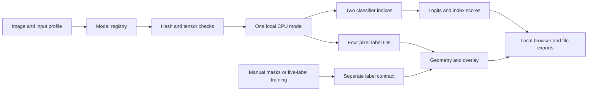

# Architecture

## Registered inference

`model_registry.json` lists the models, checkpoint and safetensors hashes,
private asset release and allowed input profiles. `supplied.py` builds the
models, imports checkpoints and prepares images. The CLI and HTTP server call
the same inference runner. Opening the UI does not load a model or asset.

A process lock allows one model operation at a time. The runner releases the
model and tensors afterward. CPU inference uses two threads. Downloads happen
only when requested. The fetch command uses the existing GitHub CLI sign-in,
checks each asset in a temporary folder and adds it to the model folder only
if the destination does not already exist.

## Label contracts and training

`contracts.py` separates `source-four` from `corrected-five`. The registered
Swin model has four output channels; the training pipeline has five. Every
report and legend carries its schema. Geometry can be shared without assigning
anatomical names or relabelling a checkpoint.

`model.py` shares the Swin backbone and decoder between explicit four- and
five-output classes. Spatial hidden states provide the decoder input.
`training.py` uses a fixed seed, patient-separated splits, two CPU threads and
no worker subprocesses. `dataset.py` combines images, capsule masks and region
masks while preserving region IDs. Training and prediction use the same input
contract. The registered four-class model has two named input profiles.

Training manifests contain architecture, labels, input settings, weight hash
and the current run’s record. Registered inference uses the fixed model registry.
Both paths load safetensors strictly. The importer reads only `.pth`
checkpoints whose hashes match the registry, using `weights_only=True`. A small NumPy scalar/dtype allowlist handles the
Swin file’s saved metric. It allows no custom Python classes or unrestricted
pickle execution.

## Analysis and serving

`pipeline.py` returns masks to the input image dimensions before measurement.
Physical units require calibration, which may differ by axis. Ellipsoid volume
also requires an independently measured third dimension. No assumed scan depth
or image-dimension disease rules are used.

`server.py` binds to localhost, bounds request sizes, rejects cross-origin
requests and accepts image bytes rather than filesystem paths. The browser
requires an input profile before inference. Each result keeps its own model
identity and settings. Classifier exports contain both logits and index scores;
they contain no disease label or ensemble verdict.
